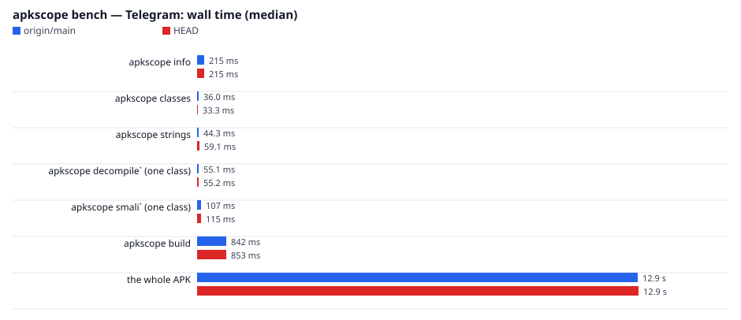
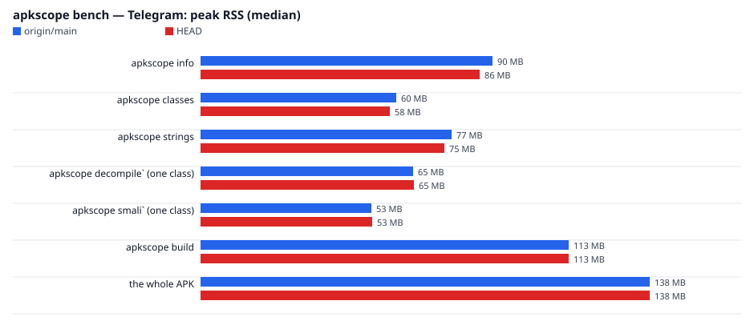

# apkscope benchmarks

apkscope is measured with one tool: the `cargo bench` harness in [`benches/`](benches).
Give it git refs, pull requests or ready-made binaries; it builds them, runs the case set
as cold processes on the APKs you point it at, and prints the comparison table — on Linux,
macOS and Windows, with nothing but the Rust toolchain that builds apkscope itself.
[Back to the README](README.md)

**Jump to:** [Run it](#run-it) · [The case set](#the-case-set) · [Compare git refs](#compare-git-refs) · [Compare binaries](#compare-binaries) · [Compare a pull request](#compare-a-pull-request) · [Race other tools](#race-other-tools) · [Output checking](#output-checking) · [Output formats](#output-formats) · [How the numbers are made](#how-the-numbers-are-made) · [Reference run: Telegram](#reference-run-telegram) · [History](#history)

## Run it

```
cargo bench --no-default-features -- --compare main --compare HEAD --apk Telegram.apk
```

The `--` matters: the flags after it belong to the harness, not to cargo. Plain
`cargo bench` measures the working tree alone — `HEAD`, uncommitted changes included.

One Markdown table per APK: a column per build, a row per case, every cell
`wall time, peak RSS` — the median of `--runs` (default 3) cold runs. `--apk` is
repeatable; without it the harness looks in `bench/apps/` (a convention — APKs are not
committed, so it is usually passed explicitly). `--case` (repeatable) and `--runs` trim
the run.

## The case set

| Row | What runs |
|---|---|
| `apkscope info` | the manifest overview of the APK |
| `apkscope classes` | every class in every DEX |
| `apkscope strings` | the whole string pool |
| `apkscope decompile` (one class) | one class as Java — the first class of `classes` output, the same class for every column |
| `apkscope smali` (one class) | the same class as Smali |
| `apkscope build` | rebuild and re-sign the whole APK |
| the whole APK | `apkscope decompile <apk>` — every class, one process |

Every run is a fresh process with `-q --no-cache`: no warm cache, no daemon, nothing
carried between runs. `--tool` columns only fill the whole-APK row.

## Compare git refs

`--compare <ref>` (repeatable, the first is the baseline) builds apkscope at each ref
and gives it a column. `HEAD` (or `.`) compiles the working tree in place; every other
ref is checked out into a worktree under `target/bench/wt/` — nothing touches your
checkout — and cached by commit sha, so two refs at one commit build once and a re-run
of the same ref is a cache hit. Each ref builds `--release --no-default-features` into
its own `CARGO_TARGET_DIR` under `target/bench/`.

## Compare binaries

`--bin <path>` (repeatable) measures ready-made apkscope binaries exactly as given — no
build. Race two local builds, or the installed release against a PR preview from
[`scripts/preview-pr.sh`](scripts/preview-pr.sh):

```
./scripts/preview-pr.sh 79
cargo bench --no-default-features \
  -- --bin "$(command -v apkscope)" --bin ~/.local/bin/apkscope-pr-79 --apk Telegram.apk
```

Every `--bin` is probed with `--version` before the first case runs, so a path that is
not an apkscope binary fails in seconds instead of after a failed row; the version it
prints lands in the table's footer next to the built refs' commit shas. With only
`--bin` columns given, the working tree is not built at all.

## Compare a pull request

`--pr <N>` (repeatable) fetches GitHub's merge ref for PR N — the same merge CI builds —
into `refs/bench/pr-N` and benches it as a `pr-N` column:

```
cargo bench --no-default-features -- --pr 79 --apk Telegram.apk
```

Without `--compare`, the base column comes first: `--base <ref>`, default `origin/main`,
refreshed by the same fetch — the tip GitHub merges the PR into, not a possibly stale
local `main`. A PR with conflicts (or a closed PR) has no merge ref; the harness falls
back to the unmerged head and says so on stderr.

`--pr` talks to `origin`, so it needs the network — everything else in the harness is
local. Pull refs live on the repository the PR targets: a clone of `suffixing/apkscope`
can bench every PR; from a fork clone, fetch upstream first or use `--bin` with a
preview from `scripts/preview-pr.sh`.

## Race other tools

`--tool <name>` (repeatable) adds an external tool as a column, found on PATH or given
as an absolute path. It runs `<tool> <apk>` in a scratch directory and fills the
whole-APK row; the apkscope-only rows show `—`.

## Output checking

`--hash` digests every run's output with SHA-256 and turns the bench into an
output-equivalence check across the apkscope columns — built refs, PRs and `--bin`
binaries alike:

- stdout for every case except `build`; for `build`, the rebuilt APK's entry list and
  CRCs, so re-signing or fresh zip timestamps cannot make two identical rebuilds look
  different
- one hash table per APK next to the timing table; every case whose digest differs
  between columns is reported on stdout *and* stderr, and the bench **exits 3**

A perf PR that also changed output says so right next to its numbers, and CI can gate
on the exit code.

## Output formats

`--format markdown` (default) prints the PR-shaped table. `--format json` dumps the same
measurements machine-readably — per column: name, exe, commit sha (built refs) or
`--version` line (`--bin`); per cell: median seconds, peak RSS bytes, digest, error.
`--format svg` writes one bar chart per APK and metric to
`docs/bench-<apk>-{time,ram}.svg`.

Exit codes: 0 = every run succeeded · 1 = a run failed · 2 = setup error · 3 = `--hash`
found differing outputs (cargo reports non-zero as a failed bench — that is the point).

Worktrees, builds, fetched refs' scratch and binaries land under `target/bench/`
(`cargo clean` removes them; `git worktree prune` clears the stale metadata a clean
leaves behind).

## How the numbers are made

- **Cold runs.** Every run is a fresh process with `-q --no-cache`; the table shows the
  median of `--runs` (default 3) — never a single sample, never a warm cache.
- **Peak RSS from the OS.** `wait4(2)`'s `ru_maxrss` on Linux and macOS,
  `GetProcessMemoryInfo` on Windows — read once when the child exits, no polling, no
  race with short-lived processes.
- **The same class everywhere.** The one-class rows decompile the class picked once from
  the first column's `classes` output, so outputs — and `--hash` digests — compare.
- **The binary that ships.** Built refs compile `--release --no-default-features`: the
  CLI + MCP server the cases exercise. The viewer is not benched.
- **Units follow the value.** Times below a second print in milliseconds, above it in
  seconds, past a minute in minutes — each cell in the unit its value calls for.

## Reference run: Telegram

Measured with the harness itself on Telegram's direct download
(`https://telegram.org/dl/android/apk`, 81.7 MB, 4 DEX files), 2026-11-24:

- machine: an Intel Xeon cloud VM (2 cores, 4 GB RAM), Linux 5.10
- command: `cargo bench --no-default-features -- --pr 79 --hash --apk Telegram.apk`
- columns: `origin/main` at `a401b62` · `pr-79` (the PR that added this harness, fetched
  as GitHub's merge ref) at `b9d7f73`

### Telegram.apk

|  | origin/main | pr-79 |
| --- | --- | --- |
| `apkscope info` | 211 ms, 86 MB | 211 ms, 86 MB |
| `apkscope classes` | 34.1 ms, 60 MB | 32.9 ms, 58 MB |
| `apkscope strings` | 58.8 ms, 77 MB | 42.8 ms, 73 MB |
| `apkscope decompile` (one class) | 55.0 ms, 65 MB | 54.9 ms, 61 MB |
| `apkscope smali` (one class) | 105 ms, 52 MB | 106 ms, 52 MB |
| `apkscope build` | 837 ms, 113 MB | 836 ms, 113 MB |
| the whole APK | 12.8 s, 138 MB | 12.8 s, 138 MB |

Columns: `origin/main` = apkscope `a401b62` · `pr-79` = apkscope `b9d7f73` (the merge
ref of [#79](https://github.com/suffixing/apkscope/pull/79) at bench time). Median of
3 cold runs; every digest under `--hash` was identical across the two columns (exit 0).

<p>
  
  
</p>

The two columns sit within noise of each other — this PR adds a bench target and docs,
no apkscope code — which is exactly what the table should show.

## History

Until this page was rewritten, it carried the cross-tool races (JADX, rust_ASC) and the
10- and 14-app cold-query tables measured by the PowerShell/Python scripts under
`bench/` — Windows-first, and a JDK for some cases. [#64](https://github.com/suffixing/apkscope/issues/64)
replaced them with the harness and retired the scripts; their tables and scripts live on
in git history, and that era's `docs/bench-*.svg` charts (TikTok, still embedded in the
README's Speed section) remain as they were measured.

[Back to the README](README.md)
